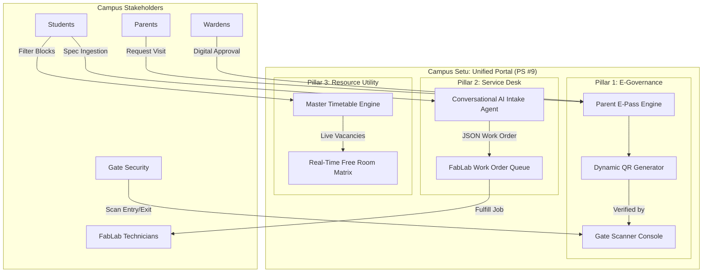

# Campus Setu: Unified Campus E-Governance & Intelligent Service Request System

**Hackathon / Ideathon:** GENESIS 2026 — Amrita Vishwa Vidyapeetham  
**Selected Track:** **Problem Statement #9 — Unified Campus E-Governance and Service Request Portal**  
 

---

## 1. Executive Summary

Residential and technological universities like Amrita operate as vibrant micro-cities with thousands of students, faculty, visiting parents, and multi-facility research infrastructure. Despite possessing modern labs and digitized student records, critical day-to-day administrative governance and resource service requests remain fragmented, manual, and paper-dependent.

**Campus Setu** unites three critical operational workflows under one cohesive, paperless digital governance ecosystem:
1. **Administrative E-Governance:** A verified **Parent Hostel Visit & Gate E-Pass** system replacing manual paper slips with dynamic, secure QR tokens.
2. **Technical Service Requests:** An **AI-Powered FabLab Prototyping Intake Desk** that automatically interviews students for technical specs (3D printing, PCB fabrication) and routes work orders to lab technicians.
3. **Campus Resource Allocation:** A **Live Classroom Occupancy & Study Space Locator** that indexes block timetables to instantly highlight available rooms for project teams.

---

## 2. Problem Statement & Friction Analysis

```
                     CURRENT FRAGMENTED PROCESSES
                     
 [Parents & Gate]      [FabLab / Makerspace]      [Classrooms & Spaces]
        │                        │                         │
Paper Visitor Slip        Unstructured Emails        Wandering corridors
Manual Warden Search      Missing print specs         to find an empty
Security Register Logs   Unscheduled machine runs    room between periods
 (90-120 min wasted)      (Delayed prototypes)       (20-30 min wasted)
```

### 2.1 The Parent Hostel Visit & Gate Clearance Bottleneck
* **The Manual Runaround:** When parents arrive to visit or pick up their ward, they must halt at the main security gate, fill out paper slips, drive to the hostel, locate an on-duty warden for a physical signature, and return the paper slip to the security guard upon exit.
* **Security & Verification Risks:** Manual paper slips are prone to forged signatures, lack real-time digital logs, and create traffic choke points at the university main gate during peak weekend hours.

### 2.2 Disorganized Prototyping & Technical Service Requests
* **Unstructured Inquiries:** Students working on hardware projects frequently require specialized campus services (3D printing, PCB CNC milling, lathe work). Requests are currently handled via ad-hoc emails or word-of-mouth.
* **Incomplete Specifications:** Students routinely forget critical engineering parameters (filament material, infill percentage, layer height, board dimensions, Gerber archives), leading to days of back-and-forth emails between students and lab technicians.

### 2.3 Inefficient Academic Space Discovery
* **Unused Capacity:** Between scheduled lectures, dozens of air-conditioned classrooms and seminar halls remain vacant. 
* **Friction for Innovators:** Hackathon teams and project groups wander from block to block looking for open spaces with power outlets, frequently being asked to leave when a surprise class begins.

---

## 3. System Architecture & Core Pillars



### Pillar 1: Smart Parent E-Pass & Hostel Clearance (E-Governance)
* **Pre-Authorization Workflow:** Parents log in or access the portal to submit a visit/pickup request with vehicle registration details and arrival window.
* **Dynamic Time-Bound QR Token:** Generates an encrypted QR token containing anti-screenshot dynamic timestamping and vehicle identity.
* **Gatekeeper Fast-Lane Console:** Web-based camera scanner verifies vehicle identity in under 1 second and registers **"Entry Logged"** or **"Exit Completed"** with instant audit logging.

### Pillar 2: Conversational AI FabLab Intake Desk (Service Request)
* **Interactive AI Triage:** A conversational agent embedded in the portal acts as a virtual lab technician, eliciting missing engineering specs (PLA vs ABS, infill %, layer heights, PCB layers, Gerber files).
* **Automated Work-Order Serialization:** Compiles specs into a structured JSON ticket with estimated completion times dispatched directly to the technician's Kanban queue.

### Pillar 3: Real-Time Classroom & Study Space Finder (Campus Utility)
* **Schedule-Aware Availability Matrix:** Cross-references academic block timetables to uncover unoccupied classrooms, seminar halls, and discussion pods in real time.
* **Smart Occupancy Badges:** Displays room status (`Vacant & Free` vs `Occupied`), seating capacities, and room amenities (projectors, AC, power strips).

---