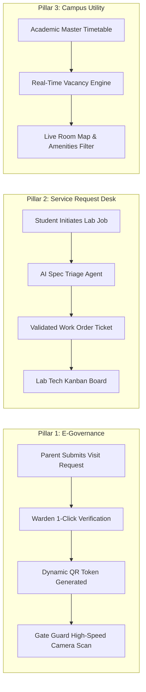

# Campus Setu — Review 1: Research & Problem Statement Understanding
**GENESIS 2026 Hackathon | Amrita Vishwa Vidyapeetham**  
**Selected Track:** Problem Statement #9 — Unified Campus E-Governance and Service Request Portal  
**Evaluation Window:** Review 1 (8:00 PM – 11:00 PM, 10th October 2026)  

---

## 📋 Executive Overview for Judges

> **The Elevator Pitch:**  
> *"Amrita operates as a 10,000+ member residential micro-city. While academic grading is digitized, high-frequency operational governance is still stranded on paper slips, unstructured emails, and corridor guesswork. **Campus Setu** is an intelligent, unified campus governance ecosystem tackling three high-friction campus workflows: verified **Parent Hostel Visit & Gate E-Passes**, an **AI-Powered FabLab Prototyping Intake Desk**, and a **Live Classroom & Study Space Locator**."*

---

## 1. 🎤 3-Minute Verbal Pitch Script (For Team Presentation)

Use this exact timing breakdown when presenting to the Review 1 panel:

```
[0:00 - 0:30]  HOOK & CAMPUS CONTEXT
"Good evening, respected evaluators. Amrita is an elite technical university and a vibrant 
residential campus. Yet, on any given Saturday afternoon, visiting parents spend 45 minutes 
standing in line at the Main Gate filling physical paper slips, hunting for hostel wardens, 
and waiting for physical signatures. Meanwhile, our hackathon teams wander across AB-1 and AB-3 
hunting for an empty classroom with power sockets, and our FabLab technicians waste days in 
email loops because students forgot to specify 3D print infill percentage or PCB layer counts."

[0:30 - 1:15]  PROBLEM STATEMENT #9 DECONSTRUCTION
"Under Problem Statement #9 — Unified Campus E-Governance and Service Request Portal, we identified 
that current campus software like AUMS is built for static academic records (attendance, grades, 
fees), but campus OPERATIONAL LIFE is real-time, physical, and cross-stakeholder. 
There is zero unified bridge connecting Gate Security, Hostel Administration, Technical Labs, 
and Student Innovators."

[1:15 - 2:15]  OUR SOLUTION: CAMPUSSYNC (3 CORE PILLARS)
"Campus Setu solves this via three synchronized modules:
 1. Administrative E-Governance: A verified Parent Hostel Visit & Gate E-Pass with dynamic, 
    time-stamped QR verification for gatekeepers and 1-click warden approvals.
 2. Intelligent Service Desk: An AI-Powered FabLab Intake Agent that acts as a virtual lab 
    technician—interviewing students to lock down mechanical/electronics specs before a 
    ticket is dispatched.
 3. Campus Utility Engine: A live Classroom Occupancy Locator that maps block schedules in 
    real time, showing vacant study and collaboration spaces immediately."

[2:15 - 3:00]  RESEARCH RIGOR & 24-HOUR HACKATHON ROADMAP
"For Review 1, we have mapped every stakeholder journey, verified data models, and designed 
the security protocol for gate clearances. As per the GENESIS timeline, our next phases 
(Review 2 & 3) will wire our full-stack architecture and AI engine, arriving at Review 4 
with a live, testable end-to-end prototype."
```

---

## 2. 🔍 Research & Friction Analysis (The Core of Review 1)

### 2.1 The Operational Bottleneck Matrix

| Stakeholder | Current Status Quo | Operational Friction | Quantified Impact |
| :--- | :--- | :--- | :--- |
| **Visiting Parents** | Physical paper visitor slip at main gate; driving to hostel; hunting for warden. | No advance notice; manual signature dependency; multiple vehicle checkpoints. | **45 to 90 mins wasted** per visit; peak-hour gate traffic jams. |
| **Gate Security** | Physical paper logbook entries; manual handwriting verification; phone calls. | Impersonation/forgery risk; no real-time warden clearance feed; no digital logs. | **3-5 mins per car** clearance time; paper registers lost or unindexed. |
| **Hostel Wardens** | Physical paper gate passes signed by hand at the hostel office desk. | Disturbed at odd hours; no asynchronous verification queue; zero audit trail. | High administrative overhead; cannot verify parent arrival status. |
| **Students (Makers / Tech)** | Unstructured emails or WhatsApp messages to FabLab technicians. | Incomplete specs (no filament type, missing infill %, wrong Gerber format). | **3 to 5 days** back-and-forth email delay before fabrication starts. |
| **FabLab Technicians** | Manual queue management; reviewing corrupt/unverified CAD & Gerber files. | Overwhelming ad-hoc requests; machine scheduling collisions; wasted raw materials. | High prototype failure rates; wasted machine hours. |
| **Student Project Teams** | Walking from room to room checking door peepholes across academic blocks. | Getting kicked out 10 mins into a group discussion when a scheduled class starts. | **20-30 mins wasted** per study session; underutilized empty classrooms. |

---

### 2.2 Why Existing Campus Systems (AUMS / Generic ERPs) Fail

```
+---------------------------------------------------------------------------------+
|                                 THE GAP IN CAMPUS TECH                          |
+---------------------------------------------------------------------------------+
| AUMS / Traditional Campus ERP          | Campus Setu (PS #9 Unified Solution)   |
+----------------------------------------+----------------------------------------+
| Built for static, scheduled records   | Built for real-time, dynamic workflows |
| (Grades, Tuition fees, Attendance)     | (Gate scans, AI lab triage, room query)|
|                                        |                                        |
| Desktop-heavy, complex administrative  | Mobile-first, instant role consoles    |
| forms with multi-screen navigation     | (Guard scanner, Parent pass, Room map) |
|                                        |                                        |
| No conversational AI or spec-gathering | Conversational AI triage agent acting  |
| capabilities for engineering labs      | as a virtual lab assistant             |
|                                        |                                        |
| Timetables locked in static PDF sheets | Queryable timetable occupancy engine   |
| or non-interactive student portals     | providing live vacancy badges          |
+----------------------------------------+----------------------------------------+
```

---

## 3. 🎯 Deep Dive: Campus Setu’s 3 Pillars



### Pillar 1: Smart Parent E-Pass & Hostel Clearance
* **Pre-Arrival Digital Induction:** Parents enter student roll number, visitor count, vehicle registration, and expected arrival window.
* **Warden Verification Queue:** Hostel wardens receive a streamlined digital queue to approve/verify student hostel checkout.
* **Encrypted Anti-Fraud QR Token:** The parent receives a time-stamped, color-shifting dynamic QR code that expires automatically after the visit window, preventing screenshot forgery.
* **Sub-Second Gatekeeper Verification:** Guard mobile/web scanner validates the pass instantly and updates the campus visitor count in real time.

### Pillar 2: Conversational AI FabLab Intake Desk
* **Interactive Engineering Interviewer:** Instead of a dumb web form, an AI assistant converses with the student:
  * *For 3D Printing:* Inquires on print resolution, infill density (%), filament material (PLA, PETG, ABS, Resin), and structural loads.
  * *For PCB Milling:* Checks layer counts (Single/Double), trace width tolerances, drill sizes, and Gerber archives.
* **Structured Work-Order Generation:** Formulates a standardized JSON job ticket with estimated material costs and turnaround estimates, routing it to the FabLab technician dashboard.

### Pillar 3: Real-Time Classroom & Study Space Finder
* **Intelligent Timetable Indexing:** Parses academic block schedule matrices to compute unoccupied lecture halls, seminar halls, and project labs at any given hour.
* **Filter by Innovation Needs:** Students can filter by specific amenities (AC, Projector, High-Capacity Power Outlets, Seating Capacity).
* **Guaranteed Free Windows:** Clearly displays *"Free for next 2 hours until 4:30 PM"* to avoid mid-session disruptions.

---

## 4. 👥 Stakeholder Persona & Journey Analysis

### Persona A: Smt. Lakshmi (Parent visiting from Chennai)
* **Goal:** Visit son at D-Block Hostel for 3 hours, hand over items, and exit before 6:00 PM.
* **Pain Points:** Dislikes paperwork, hates standing in lines under the sun, nervous about gate procedures.
* **Campus Setu Journey:** Fills a 3-field form on her phone $\rightarrow$ receives dynamic QR pass $\rightarrow$ guard scans at gate in 3 seconds $\rightarrow$ gate opens seamlessly.

### Persona B: Adithya (3rd Year B.Tech Robotics Lead)
* **Goal:** Rapidly 3D-print a custom drone motor mount for a national competition before Monday.
* **Pain Points:** FabLab technician rejected his previous raw STL file because shell wall thickness and infill were not documented; lost 4 days.
* **Campus Setu Journey:** Chats with Campus Setu AI intake $\rightarrow$ AI prompts him for infill percentage and nozzle tolerance $\rightarrow$ ticket verified and placed on the lab's priority print queue.

### Persona C: Havildar Murugesan (Main Gate Security Officer)
* **Goal:** Verify incoming vehicles quickly without causing backups on the Coimbatore-Palakkad highway.
* **Pain Points:** Handwriting in paper registers is illegible; cannot confirm if a student is actually permitted to leave hostel with parents.
* **Campus Setu Journey:** Point tablet camera at QR code $\rightarrow$ green "VALIDATED" flash with student photo and vehicle registration $\rightarrow$ clicks "Log Entry".

---

## 5. ⏱️ 24-Hour Hackathon Delivery Roadmap

Aligned strictly with the **GENESIS '26 Tentative Agenda**:

```
[10th Oct 8:00 PM - 11:00 PM] ──► REVIEW 1: Problem Statement & Research Rigor (NOW)
│   • Stakeholder problem validation & friction analysis
│   • System architecture definition (3 Pillars)
│   • Data contracts & UX workflow blueprints
│
[10th Oct 11:00 PM - 2:00 AM] ──► REVIEW 2: Tech Stack & AI Usage
│   • Frontend: Responsive Web Portal (Clean, accessible, role-tailored consoles)
│   • Backend: FastAPI / Node micro-services & dynamic QR generation engine
│   • AI Model: Conversational triage prompt engineering with structured JSON output
│
[11th Oct 2:00 AM - 5:00 AM]  ──► REVIEW 3: Technologies & Methodologies Used
│   • Database schema (PostgreSQL / SQLite) with relational integrity for gate logs
│   • Timetable time-slot collision algorithm for vacancy computation
│   • Security implementation (time-bound expiring hashes, role access controls)
│
[11th Oct 5:00 AM - 8:00 AM]  ──► REVIEW 4: Prototype Demo
│   • Live end-to-end demo of parent QR generation & gatekeeper mobile scan
│   • Live AI FabLab conversation producing a structured technician ticket
│   • Live classroom availability search with dynamic vacancy badges
│
[11th Oct 8:30 AM - 1:00 PM]  ──► FINAL PITCH & TOP 10 PRESENTATION
```

---

## 6. 🛡️ Review 1 Anticipated Panel Questions & Winning Defenses

### Q1: *"Why are you bundling three different things (Parent Pass, FabLab, Classrooms) into one project?"*
> **Defense:**  
> *"That is the exact core definition of **Problem Statement #9: Unified Campus E-Governance & Service Request Portal**. A university is not just an academic portal—it is an ecosystem. Currently, each of these needs is handled by separate fractured tools (paper for gate, emails for labs, physical scouting for rooms). Campus Setu proves that a **single unified identity and permissions layer** can power administrative security, research service requests, and physical infrastructure utilization under one single sign-on."*

### Q2: *"Can't parents just use Google Forms and WhatsApp?"*
> **Defense:**  
> *"Google Forms has zero verification or security controls. Anyone can submit fake details or screenshot an old confirmation. Furthermore, Google Forms cannot generate a dynamic, anti-screenshot time-bound token, cannot trigger live gatekeeper validation, and provides no audit trail for warden hostel clearance."*

### Q3: *"How does the AI in the FabLab intake add actual value over a static form?"*
> **Defense:**  
> *"Static forms fail because novice students don't know what parameters matter (e.g. they choose 100% infill for a decorative bracket, wasting 12 hours of print time and filament, or they upload a multi-layer Gerber without drill files). The AI acts as an expert lab tutor: it inspects the student's project goal, asks clarifying questions in natural language, advises optimal material selection, and prevents expensive lab machine bottlenecks."*

### Q4: *"What is the realistic scope you will deliver during the hackathon?"*
> **Defense:**  
> *"In these 24 hours, we are delivering a functional, live working prototype across all 3 pillars:
> 1. A working Parent E-Pass generator + instant Web Camera QR Gate Scanner.
> 2. An interactive conversational AI agent producing structured FabLab work orders.
> 3. A responsive interactive Classroom Vacancy Matrix with live status badges."*
