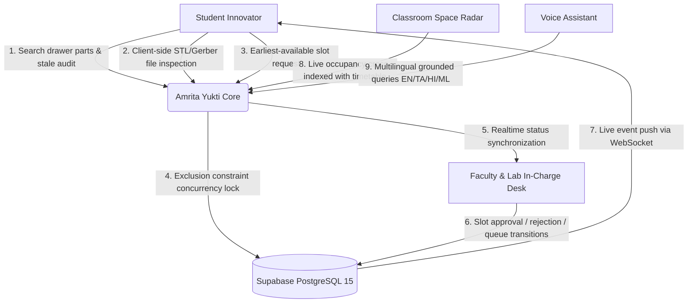

# 01 — Project Overview: Amrita Yukti

> **Institution:** Amrita Vishwa Vidyapeetham, Coimbatore Campus  
> **Event:** GENESIS 2026 Hackathon  
> **Project Name:** Amrita Yukti (Derived from Sanskrit *Yukti* — meaning ingenuity, skillful innovation, and creative synergy)  
> **Repository:** `Genesis---Unscripted`  

---

## 1. Problem Statement & Campus Reality

Modern engineering campuses house specialized, capital-intensive prototyping machinery and electronic hardware components spread across departmental silos:
* **Digital Fabrication & 3D Printing:** Bambu Lab X1-Carbon, Prusa MK4 CoreXY printers located in Central FabLab / Mechanical workshops.
* **PCB Prototyping & EDA:** Voltera V-One PCB printers, stencil printers, SMD reflow stations in ECE/EEE labs.
* **Compute & AI Workstations:** Multi-GPU workstations (Dell Precision RTX 4090) in AI/HPC labs.
* **Hardware Drawers & Passives:** Thousands of discrete passives (resistors, capacitors, ICs, microcontrollers like ESP32/STM32) in lab component bins.
* **Academic Spaces:** Lecture halls and seminar rooms subject to ad-hoc project meetings, unannounced takeovers, and schedule drift.

### The Silo Problem
1. **Student Frustration:** Innovators spend hours walking between academic blocks (AB-1, AB-2, FabLab) searching for available machines or simple components (e.g., a specific 10k resistor or ESP32 devkit).
2. **Double-Bookings & Scheduling Chaos:** Manual Google Forms or paper sign-in registers lead to overlapping reservations, no-shows, and idle machines.
3. **Faculty & In-Charge Overhead:** Lab in-charges are inundated with WhatsApp messages and emails for file checks, safety clearances, and stock updates.
4. **Stale Hardware Inventories:** Drawers accumulate parts without audit trails. Components sit idle past 30 days without visibility.
5. **Classroom Drift:** Timetable schedules diverge from real occupancy due to student club sessions, remedial lectures, or unannounced room takeovers.

---

## 2. The Solution: Amrita Yukti

**Amrita Yukti** is a centralized innovation facility booking, prototyping intake, and hardware inventory matching portal built specifically for campus environments. It bridges students, faculty, and lab in-charges into a cohesive, authenticated operational loop.

---

## 3. User Personas & Roles

Amrita Yukti implements strict Role-Based Access Control (RBAC) backed by PostgreSQL Row Level Security (RLS) and server-side verification:

| Role | Target Demographic | Key Responsibilities & Capabilities |
| :--- | :--- | :--- |
| **`student`** | Undergraduate & postgraduate student innovators, club project leads | • Search hardware components by drawer label and physical location. • Inspect 3D models (`.stl`) and PCB Gerber (`.zip`) client-side. • Book lab equipment via earliest-slot algorithm. • Hands-free voice assistant in English, Tamil, Hindi, Malayalam. • Submit crowdsourced classroom occupancy reports. • View personal bookings and job queue statuses. |
| **`faculty`** | Professors, project guides, department mentors | • Review and approve student machine reservations. • Reserve classrooms/lecture halls for ad-hoc remedial classes/evaluations. • Raise component procurement / purchase requests for project tracks. • Monitor department utilization dashboards. |
| **`lab_incharge`** | Technical lab officers, FabLab managers | • Manage active equipment queues (3D printers, PCB mills). • Bulk import inventory CSVs with automatic deduplication. • Transition job statuses (`queued`, `in_progress`, `done`). • Prevent machine hoarding and handle equipment maintenance flags. |
| **`admin`** | Department heads, systems administrators | • User role management and privilege escalation locks. • Timetable master CSV bulk import. • Moderate crowdsourced classroom occupancy reports and unflag rooms. • Review immutable security audit logs (`audit_log`). |

---

## 4. Key Innovations & Novelty

1. **Deterministic Earliest-Available Scheduling with Database-Level Guarantees:**
   * Instead of naive calendar polling or complex black-box schedulers, Amrita Yukti runs a deterministic interval scanner (`server/lib/scheduler.js`) across campus working hours (08:30–17:30 IST) in 15-minute steps.
   * Concurrency correctness is guaranteed by PostgreSQL's `btree_gist` exclusion constraint (`EXCLUDE USING gist`), guaranteeing zero double-bookings under network races.
2. **Client-Side Pre-Flight File Inspection:**
   * High-cost slicing tools often require heavy server memory or paid cloud infrastructure. Amrita Yukti decomposes 3D meshes in the browser using signed tetrahedron math to compute volume and print duration instantly, coupled with magic-byte checks (`solid` / binary STL headers, ZIP archive inspection).
3. **Resilient Multilingual Voice Assistant:**
   * Built for South Indian campus linguistic diversity. Handles voice and text queries in English, Tamil (தமிழ்), Hindi (हिन्दी), and Malayalam (മലയാളം) using unicode script detection and localized response templates grounded directly in live database state.
   * Features an optional server-side Google Gemini Flash classification fallback (`gemini-2.5-flash`), operating completely without heavy local models or tunneling bridges.
4. **Live Synchronization via Supabase Realtime:**
   * Native WebSocket postgres-change subscriptions allow faculty approval actions to reflect instantaneously on the student's screen, with automatic 20-second polling fallback if network conditions degrade.
5. **Classroom Space Radar with Timetable Reconciliation:**
   * Reconciles official timetable schedules against crowdsourced student reports. Rooms occupied without official scheduling trigger automated threshold alerts (2+ reports/week) for department review.

---

## 5. Scope & Explicit Non-Goals (What is NOT in Scope)

To maintain absolute architectural honesty and defensibility during review panels:

### In Scope (Implemented in Code)
* Full role-based authentication with `@cb.amrita.edu` and `@cb.students.amrita.edu` email domain enforcement.
* PostgreSQL 15 schema with 16 tables, RLS policies, trigger-based role protection, and immutable audit logging.
* Earliest-available scheduling algorithm with 15-minute grid alignment and IST working-hours bounding.
* Concurrency conflict handling returning `409 Conflict` with dynamic alternative slot recommendations.
* Client-side STL volume calculation and Gerber file structure verification.
* In-memory Express rate limiting (standard 120 req/min, sensitive 25 req/min on chat).
* Realtime booking state push notifications with polling fallback.
* 18 unit tests with Vitest covering scheduling, analytics calculations, and chatbot fallback.

### Out of Scope / Roadmap (Explicitly NOT in Code)
* **Cloud File Storage Bucket:** Binary STL and Gerber files are inspected in the browser; binary files are not uploaded to an S3/Supabase Storage bucket (metadata and estimates are saved to PostgreSQL).
* **Distributed Redis Rate Limiter:** Current rate limiting is in-memory per Node.js serverless instance.
* **Physical Hardware Lockouts / RFID Turnstiles:** Physical access control is managed via student check-in within the portal UI rather than IoT relays.
* **Campus Single Sign-On (SAML/CAS):** Relies on Supabase Auth email verification rather than institutional Microsoft Entra / CAS SSO.
