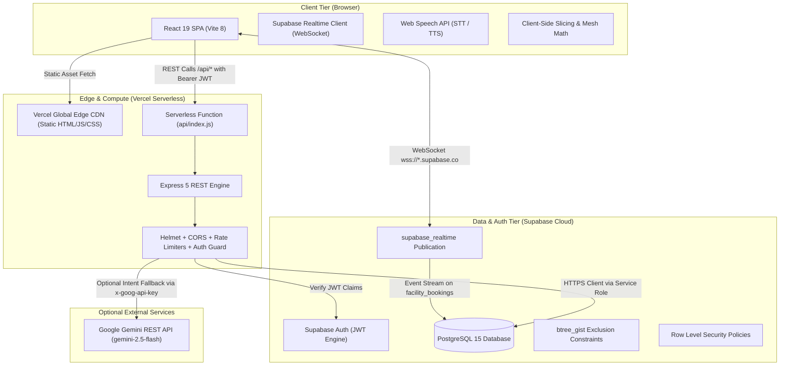
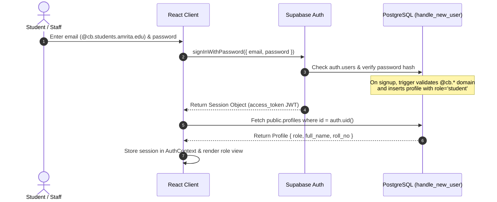
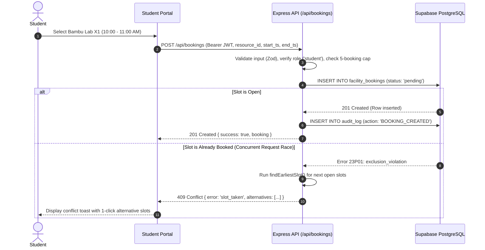
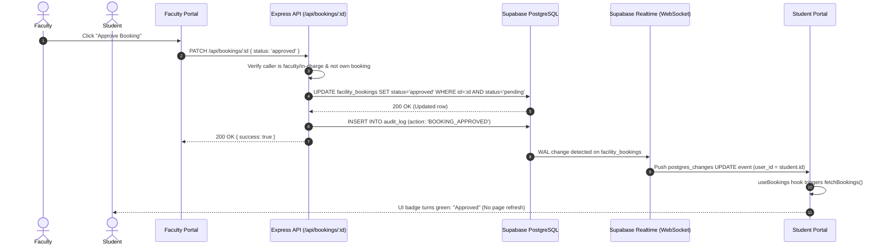
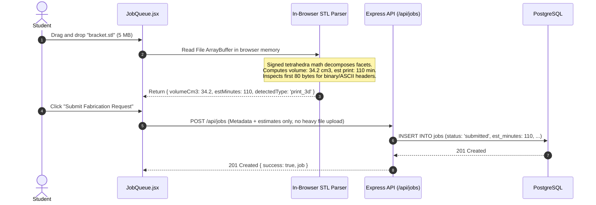
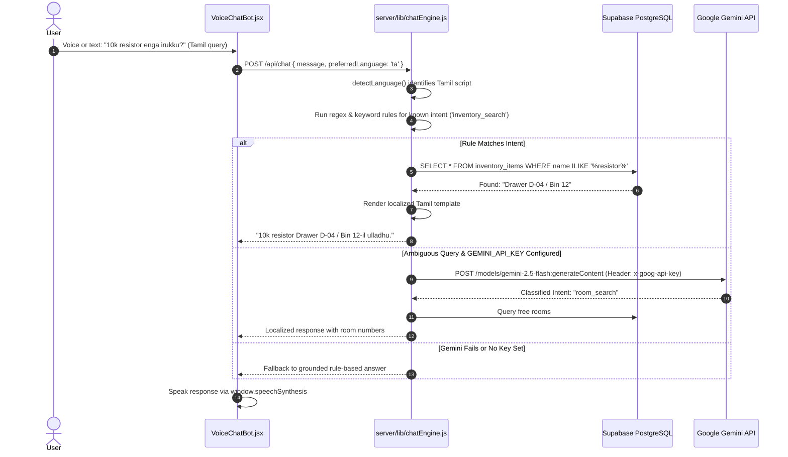

# 03 — System Architecture & Technical Specifications

This document defines the architectural topology, request lifecycles, network traffic management, and data access tiers of **Amrita Yukti**.

---

## 1. End-to-End System Topology

---

## 2. Codebase Layer Structure

| Directory | Layer Purpose | Key Files & Responsibilities |
| :--- | :--- | :--- |
| `src/components/` | UI Presentation & Views | Modular React components for each portal view (`StudentPortal.jsx`, `FacultyPortal.jsx`, `AdminPortal.jsx`, `JobQueue.jsx`, `ClassroomOccupancyModule.jsx`, `VoiceChatBot.jsx`). |
| `src/services/` | API Abstraction | `api.js`: Centralized Axios/fetch client attaching Supabase session tokens, handling errors, and routing to `/api/*`. |
| `src/context/` | Global State Management | `AuthContext.jsx`: Session persistence, role distribution, and domain enforcement. |
| `src/hooks/` | Reusable React Hooks | `useBookings.js`: Supabase Realtime channel subscription with automatic 20-second polling fallback. |
| `src/i18n/` | Localization Engine | `index.js`, `en.json`, `ta.json`, `hi.json`, `ml.json`: Multilingual translation tables. |
| `server/routes/` | API Endpoints | Modular Express 5 sub-routers (`bookings.js`, `inventory.js`, `jobs.js`, `rooms.js`, `chat.js`, `analytics.js`, `admin.js`). |
| `server/lib/` | Core Business Logic | Pure algorithms and helpers: `scheduler.js` (interval allocation), `chatEngine.js` (NLP & Gemini), `fileRouter.js` (magic bytes), `time.js` (IST calculations), `supabase.js` (client & audit logging). |
| `server/middleware/` | Security & Auth | `auth.js` (`requireAuth`, `requireRole`), `security.js` (Helmet, CORS, rate limiters). |
| `supabase/migrations/` | Database Schema & SQL | `001_init.sql` $\rightarrow$ `005_realtime.sql`: DDL, RLS, triggers, indexes, and Realtime publications. |
| `scripts/` | Testing & Seeding CLI | `seed-demo-users.mjs` (demo provisioning), `concurrency-test.mjs` (20-worker race), `brute-force-demo.mjs` (rate limit test). |

---

## 3. Detailed Request Lifecycles (Sequence Diagrams)

### 3.1 Authentication & Role Derivation Flow

### 3.2 Equipment Booking & Concurrency Conflict Flow

### 3.3 Slot Approval & Realtime Push Flow

### 3.4 Client-Side File Inspection Flow

### 3.5 Multilingual Chatbot Flow

---

## 4. Network Traffic Management & Scalability

1. **Edge CDN Distribution:** All client assets (HTML, CSS, JS bundles, icons) are served via Vercel's global Anycast Edge Network, ensuring instant static delivery and zero compute overhead for page loads.
2. **Serverless Scalability:** Backend endpoints operate as stateless Vercel Serverless Functions (`api/index.js`), auto-scaling on demand from zero to handle registration spikes and slot opening rushes.
3. **Dual Tier Rate Limiting (`express-rate-limit`):**
   * **Standard Limiter:** 120 requests / minute per client IP across all regular endpoints.
   * **Sensitive Limiter:** 25 requests / minute per client IP applied to `/api/chat` and `/api/ai/chat` to prevent denial-of-service and LLM quota exhaustion.
   * *Architecture Note:* On serverless infrastructure, in-memory rate limiting applies per serverless instance. `app.set('trust proxy', 1)` is enabled to ensure the correct client IP is evaluated behind reverse proxies.
4. **Request Body Caps:** `express.json({ limit: '100kb' })` prevents memory exhaustion attacks from oversized JSON payloads.
5. **Database-Side Indexing:**
   * Compound index on `facility_bookings (resource_id, start_ts, end_ts)`.
   * GIST index on `facility_bookings USING gist (resource_id WITH =, tstzrange(start_ts, end_ts) WITH &&)`.
   * Unique natural key index on `inventory_items (lab_id, item_key)`.
6. **Lazy No-Show Release:** Rather than maintaining a memory-intensive background polling daemon, `autoReleaseNoShows()` runs lazily on booking queries, checking if approved slots started >15 minutes ago with no check-in, freeing them automatically.
7. **Free-Tier Constraints & Mitigations:**
   * **Supabase Free Tier:** Inactive projects pause after approximately 7 days of inactivity. *Mitigation:* The team wakes the project prior to reviews.
   * **Realtime Connection Limits:** Free tier supports up to 200 concurrent WebSocket connections. *Mitigation:* The `useBookings` hook terminates channels cleanly on unmount (`removeChannel`) and falls back to polling if WebSocket quota is reached.

---

## 5. Data Access & Visibility Matrix

| Entity / Table | `student` | `faculty` | `lab_incharge` | `admin` |
| :--- | :---: | :---: | :---: | :---: |
| **`public.profiles`** | Own row only | Own row + student names | Own row + lab students | All profiles |
| **`public.facility_bookings`** | Own bookings only | Department bookings | Lab bookings | All bookings |
| **`public.jobs`** | Own jobs only | Department jobs | Lab jobs | All jobs |
| **`public.inventory_items`** | View catalogue | View catalogue | View & Import (assigned lab) | Full CRUD |
| **`public.classrooms`** | View status | View status | View status | Manage & Unflag |
| **`public.timetables`** | View schedules | View schedules | View schedules | Bulk Import CSV |
| **`public.occupancy_reports`** | Submit report | View all & submit | View all & submit | Moderate & Resolve |
| **`public.room_bookings`** | View schedule | Book & Cancel own | View schedule | Full CRUD |
| **`public.purchase_requests`** | ❌ Forbidden | Create & View own | Create & View own | Approve / Reject |
| **`public.audit_log`** | ❌ Forbidden | ❌ Forbidden | ❌ Forbidden | Read-only access |

---

## 6. Timezone Architecture (UTC vs. IST)

* **Server Runtime:** Node.js executes in UTC standard time on Vercel and local environments (`new Date().toISOString()`).
* **Database Storage:** All timestamp columns use PostgreSQL `TIMESTAMPTZ` (`TIMESTAMP WITH TIME ZONE`), standardizing on ISO 8601 UTC representation (`YYYY-MM-DDTHH:mm:ss.sssZ`).
* **Campus Business Hours (IST):** Amrita Coimbatore operates in Indian Standard Time (`UTC+05:30`, offset `330` minutes).
* **Time Conversion Module ([`server/lib/time.js`](file:///d:/Project/Hackathon/server/lib/time.js)):**
  * `istNow()`: Converts current UTC instant to IST day name (`Monday`), IST date string (`YYYY-MM-DD`), and IST clock time (`HH:mm`).
  * `istDayBounds(dateStr)`: Computes UTC start/end boundaries for an IST calendar day so database queries filter accurately without timezone slippage.
  * `tzOffsetMin: 330` in [`server/lib/scheduler.js`](file:///d:/Project/Hackathon/server/lib/scheduler.js): Ensures 08:30–17:30 working hours are strictly applied in Coimbatore local time.
