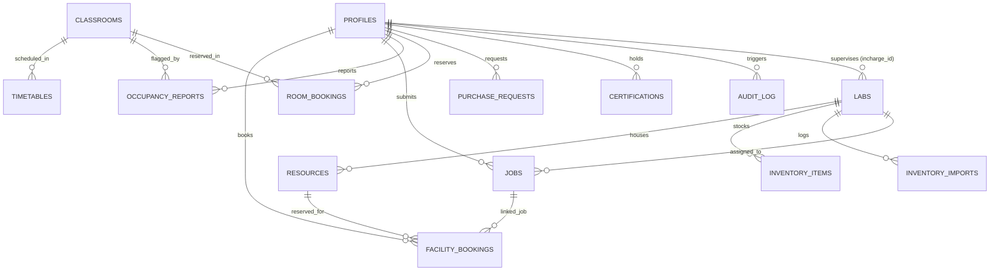

# 04 — Database Schema, RLS Policies & Entity Relationships

This document specifies the PostgreSQL 15 database schema for **Amrita Yukti**, generated directly from migrations `001_init.sql` through `005_realtime.sql`.

---

## 1. Entity-Relationship (ER) Diagram



---

## 2. Helper Functions & Security Definers

### 2.1 Role Evaluation Helpers
```sql
-- Checks if current authenticated user has 'admin' role
CREATE OR REPLACE FUNCTION public.is_admin()
RETURNS boolean AS $$
  SELECT EXISTS (
    SELECT 1 FROM public.profiles
    WHERE id = auth.uid() AND role = 'admin'
  );
$$ LANGUAGE sql SECURITY DEFINER STABLE SET search_path = public;

-- Checks if current user is faculty, lab in-charge, or admin
CREATE OR REPLACE FUNCTION public.is_staff()
RETURNS boolean AS $$
  SELECT EXISTS (
    SELECT 1 FROM public.profiles
    WHERE id = auth.uid() AND role IN ('faculty', 'lab_incharge', 'admin')
  );
$$ LANGUAGE sql SECURITY DEFINER STABLE SET search_path = public;
```

### 2.2 Domain Check & Auto-Profile Trigger (`handle_new_user`)
Runs on `auth.users` upon signup:
* **Domain Check:** Rejects signups not ending in `@cb.amrita.edu`, `@cb.students.amrita.edu`, or `@amrita.edu`.
* **Privilege Lockdown:** Ignores any client-supplied role metadata; **always** inserts into `public.profiles` with `role = 'student'`.

### 2.3 Role Escalation Guard Trigger (`guard_profile_update`)
Runs `BEFORE UPDATE ON public.profiles`:
* Blocks any update to `role` or `id` unless `public.is_admin()` is true or executed via Supabase Service Role (`auth.uid() IS NULL`).

---

## 3. Database Table Definitions

### 1. `public.profiles`
User identity and demographic profile extending Supabase `auth.users`.
* `id` (`UUID PRIMARY KEY REFERENCES auth.users(id) ON DELETE CASCADE`)
* `full_name` (`TEXT NOT NULL`)
* `role` (`TEXT NOT NULL DEFAULT 'student' CHECK (role IN ('student', 'faculty', 'lab_incharge', 'admin'))`)
* `roll_no` (`TEXT`)
* `emp_id` (`TEXT`)
* `department` (`TEXT NOT NULL DEFAULT 'General'`)
* `batch` (`TEXT NOT NULL DEFAULT '2023-2027'`)
* `preferred_language` (`TEXT NOT NULL DEFAULT 'en' CHECK (preferred_language IN ('en', 'ta', 'hi', 'ml'))`)
* `created_at` / `updated_at` (`TIMESTAMPTZ NOT NULL DEFAULT NOW()`)
* **RLS Policies:**
  * `profiles_select`: `SELECT TO authenticated USING (id = auth.uid() OR public.is_staff())`.
  * Direct updates guarded by `guard_profile_update()`.

### 2. `public.labs`
Innovation and prototyping facilities across campus.
* `id` (`TEXT PRIMARY KEY`) — e.g. `'lab-fablab'`, `'lab-pcb-eda'`, `'lab-ai-hpc'`
* `name` (`TEXT NOT NULL`)
* `block` (`TEXT NOT NULL`)
* `floor` (`INTEGER NOT NULL DEFAULT 1`)
* `incharge_id` (`UUID REFERENCES public.profiles(id)`)
* `description` (`TEXT`)
* `created_at` (`TIMESTAMPTZ DEFAULT NOW()`)
* **RLS Policies:**
  * `labs_select`: Publicly readable by all authenticated users.
  * `labs_write`: `public.is_admin()`.

### 3. `public.resources`
Individual machines and fabrication workstations within labs.
* `id` (`TEXT PRIMARY KEY`) — e.g. `'res-3d-bambu-x1'`, `'res-pcb-voltera-v2'`
* `lab_id` (`TEXT NOT NULL REFERENCES public.labs(id) ON DELETE CASCADE`)
* `name` (`TEXT NOT NULL`)
* `kind` (`TEXT NOT NULL CHECK (kind IN ('printer_3d', 'pcb_mill', 'workstation', 'laser', 'testing_station'))`)
* `status` (`TEXT NOT NULL DEFAULT 'ok' CHECK (status IN ('ok', 'maintenance', 'retired'))`)
* `requires_cert` (`BOOLEAN NOT NULL DEFAULT false`)
* `created_at` (`TIMESTAMPTZ DEFAULT NOW()`)
* **RLS Policies:**
  * `resources_select`: Read by all authenticated users.
  * `resources_write`: `public.is_admin()`.

### 4. `public.facility_bookings`
Core machine reservations guarded by Postgres exclusion constraints.
* `id` (`TEXT PRIMARY KEY`)
* `resource_id` (`TEXT NOT NULL REFERENCES public.resources(id) ON DELETE CASCADE`)
* `user_id` (`UUID NOT NULL REFERENCES public.profiles(id) ON DELETE CASCADE`)
* `job_id` (`TEXT REFERENCES public.jobs(id) ON DELETE SET NULL`)
* `start_ts` (`TIMESTAMPTZ NOT NULL`)
* `end_ts` (`TIMESTAMPTZ NOT NULL`)
* `status` (`TEXT NOT NULL DEFAULT 'pending' CHECK (status IN ('pending', 'approved', 'rejected', 'cancelled', 'completed', 'no_show'))`)
* `purpose` (`TEXT DEFAULT ''`)
* `checked_in_at` (`TIMESTAMPTZ`)
* `created_at` (`TIMESTAMPTZ DEFAULT NOW()`)
* **Constraints & Indexes:**
  * **Exclusion Constraint:** `EXCLUDE USING gist (resource_id WITH =, tstzrange(start_ts, end_ts) WITH &&) WHERE (status IN ('pending', 'approved'))` (requires `CREATE EXTENSION IF NOT EXISTS btree_gist;`).
  * `CHECK (end_ts > start_ts)`.
* **RLS Policies:**
  * `facility_bookings_select`: `USING (user_id = auth.uid() OR public.is_staff())`.
  * Direct insert/update from client removed in migration 004; all state changes routed through Express API via service role.

### 5. `public.jobs`
FabLab and PCB intake work orders with client-calculated file estimates.
* `id` (`TEXT PRIMARY KEY`)
* `user_id` (`UUID NOT NULL REFERENCES public.profiles(id) ON DELETE CASCADE`)
* `lab_id` (`TEXT NOT NULL REFERENCES public.labs(id) ON DELETE CASCADE`)
* `kind` (`TEXT NOT NULL CHECK (kind IN ('print_3d', 'pcb', 'laser', 'other'))`)
* `title` (`TEXT NOT NULL`)
* `file_name` (`TEXT NOT NULL`)
* `file_ext` (`TEXT NOT NULL`)
* `file_path` (`TEXT DEFAULT ''`)
* `detected_by` (`TEXT DEFAULT 'auto'`)
* `est_minutes` (`INTEGER NOT NULL DEFAULT 60`)
* `est_material_g` (`NUMERIC(8,2) NOT NULL DEFAULT 0`)
* `params` (`JSONB NOT NULL DEFAULT '{}'::jsonb`)
* `status` (`TEXT NOT NULL DEFAULT 'submitted' CHECK (status IN ('submitted', 'queued', 'approved', 'in_progress', 'done', 'rejected'))`)
* `created_at` / `updated_at` (`TIMESTAMPTZ DEFAULT NOW()`)
* **RLS Policies:**
  * `jobs_select`: `USING (user_id = auth.uid() OR public.is_staff())`.
  * Writes handled through Express API service-role key.

### 6. `public.inventory_items`
Component stock in lab drawers with natural key deduplication.
* `id` (`TEXT PRIMARY KEY`)
* `lab_id` (`TEXT NOT NULL REFERENCES public.labs(id) ON DELETE CASCADE`)
* `item_key` (`TEXT NOT NULL`) — natural key: `lower(trim(part_no || name))`
* `name` (`TEXT NOT NULL`)
* `part_no` (`TEXT DEFAULT ''`)
* `category` (`TEXT NOT NULL DEFAULT 'General'`)
* `quantity` (`INTEGER NOT NULL DEFAULT 0 CHECK (quantity >= 0)`)
* `location` (`TEXT DEFAULT ''`) — e.g. `'Drawer D-04 / Bin 12'`
* `updated_by` (`UUID REFERENCES public.profiles(id)`)
* `updated_at` (`TIMESTAMPTZ DEFAULT NOW()`)
* **Unique Index:** `CREATE UNIQUE INDEX inventory_items_lab_key_uniq ON public.inventory_items (lab_id, item_key);`
* **RLS Policies:**
  * `inventory_select`: All authenticated users can view.
  * `inventory_write`: `public.is_admin() OR EXISTS (SELECT 1 FROM public.labs l WHERE l.id = lab_id AND l.incharge_id = auth.uid())`.

### 7. `public.inventory_imports`
Ledger of CSV inventory uploads.
* `id` (`BIGSERIAL PRIMARY KEY`)
* `lab_id` (`TEXT NOT NULL REFERENCES public.labs(id)`)
* `uploaded_by` (`UUID NOT NULL REFERENCES public.profiles(id)`)
* `filename` (`TEXT NOT NULL`)
* `row_count` (`INTEGER NOT NULL`)
* `created_at` (`TIMESTAMPTZ DEFAULT NOW()`)

### 8. `public.certifications`
Machine safety certificates held by students.
* `id` (`BIGSERIAL PRIMARY KEY`)
* `user_id` (`UUID NOT NULL REFERENCES public.profiles(id) ON DELETE CASCADE`)
* `resource_kind` (`TEXT NOT NULL`)
* `issued_at` (`TIMESTAMPTZ DEFAULT NOW()`)
* `expires_at` (`TIMESTAMPTZ`)
* **Unique Constraint:** `UNIQUE (user_id, resource_kind)`
* **RLS Policies:**
  * `certifications_select`: `user_id = auth.uid() OR public.is_staff()`.
  * `certifications_write`: `public.is_admin()`.

### 9. `public.classrooms`
Campus lecture rooms and auditoriums.
* `id` (`TEXT PRIMARY KEY`) — e.g. `'AB1-101'`, `'AB2-204'`
* `room_number` (`TEXT NOT NULL`)
* `block` (`TEXT NOT NULL`)
* `floor` (`INTEGER NOT NULL DEFAULT 1`)
* `capacity` (`INTEGER NOT NULL DEFAULT 60`)
* `room_type` (`TEXT NOT NULL DEFAULT 'lecture_hall'`)
* `amenities` (`TEXT[] DEFAULT '{}'`)
* `is_flagged` (`BOOLEAN DEFAULT false`)
* `flag_reason` (`TEXT`)
* `flag_count` (`INTEGER DEFAULT 0`)
* `flagged_batch` / `flagged_department` / `flagged_purpose` (`TEXT`)
* `last_flagged_at` / `updated_at` (`TIMESTAMPTZ DEFAULT NOW()`)

### 10. `public.timetables`
Scheduled lectures cross-referenced by the Classroom Space Radar.
* `id` (`BIGSERIAL PRIMARY KEY`)
* `room_id` (`TEXT NOT NULL REFERENCES public.classrooms(id) ON DELETE CASCADE`)
* `day_of_week` (`TEXT NOT NULL CHECK (day_of_week IN ('Monday', 'Tuesday', 'Wednesday', 'Thursday', 'Friday', 'Saturday', 'Sunday'))`)
* `slot_number` (`INTEGER NOT NULL CHECK (slot_number BETWEEN 1 AND 8)`)
* `start_time` / `end_time` (`TIME NOT NULL`)
* `subject_name` (`TEXT NOT NULL`)
* `subject_code` (`TEXT DEFAULT ''`)
* `department` (`TEXT NOT NULL`)
* `batch` (`TEXT NOT NULL`)
* `is_lab` (`BOOLEAN DEFAULT false`)
* `faculty_name` (`TEXT DEFAULT 'Faculty In-Charge'`)

### 11. `public.occupancy_reports`
Crowdsourced student reports of unscheduled room occupancy.
* `id` (`BIGSERIAL PRIMARY KEY`)
* `room_id` (`TEXT NOT NULL REFERENCES public.classrooms(id) ON DELETE CASCADE`)
* `reporter_id` (`UUID NOT NULL REFERENCES public.profiles(id)`)
* `reporter_name` / `reporter_roll_no` / `reporter_role` (`TEXT`)
* `report_type` (`TEXT DEFAULT 'unscheduled_occupancy'`)
* `reported_batch` / `reported_department` / `purpose` (`TEXT`)
* `occupancy_level` (`TEXT DEFAULT 'Full'`)
* `is_lab_class` (`BOOLEAN DEFAULT false`)
* `status` (`TEXT DEFAULT 'active' CHECK (status IN ('active', 'resolved', 'dismissed'))`)
* `created_at` (`TIMESTAMPTZ DEFAULT NOW()`)

### 12. `public.room_bookings`
Ad-hoc faculty classroom reservations.
* `id` (`BIGSERIAL PRIMARY KEY`)
* `room_id` (`TEXT NOT NULL REFERENCES public.classrooms(id) ON DELETE CASCADE`)
* `faculty_id` (`UUID NOT NULL REFERENCES public.profiles(id)`)
* `booking_date` (`DATE NOT NULL`)
* `slot_number` (`INTEGER NOT NULL CHECK (slot_number BETWEEN 1 AND 8)`)
* `purpose` (`TEXT NOT NULL`)
* `status` (`TEXT DEFAULT 'approved' CHECK (status IN ('approved', 'cancelled', 'blocked'))`)
* `created_at` (`TIMESTAMPTZ DEFAULT NOW()`)
* **Unique Constraint:** `UNIQUE (room_id, booking_date, slot_number)`

### 13. `public.purchase_requests`
Department hardware procurement pipeline.
* `id` (`BIGSERIAL PRIMARY KEY`)
* `lab_id` (`TEXT NOT NULL REFERENCES public.labs(id)`)
* `requested_by` (`UUID NOT NULL REFERENCES public.profiles(id)`)
* `item` (`TEXT NOT NULL`)
* `qty` (`INTEGER NOT NULL CHECK (qty > 0)`)
* `reason` (`TEXT DEFAULT ''`)
* `status` (`TEXT DEFAULT 'pending' CHECK (status IN ('pending', 'ordered', 'received', 'rejected'))`)
* `created_at` (`TIMESTAMPTZ DEFAULT NOW()`)

### 14. `public.audit_log`
Immutable system audit trail.
* `id` (`BIGSERIAL PRIMARY KEY`)
* `actor_id` (`UUID REFERENCES public.profiles(id)`)
* `action` (`TEXT NOT NULL`)
* `entity` (`TEXT NOT NULL`)
* `entity_id` (`TEXT`)
* `meta` (`JSONB DEFAULT '{}'::jsonb`)
* `ip_address` (`TEXT`)
* `created_at` (`TIMESTAMPTZ DEFAULT NOW()`)

### 15. `public.portal_settings` & 16. `public.portal_pages`
Campus portal banner configuration and dynamic CMS page metadata.

---

## 4. Realtime Publication Details (`005_realtime.sql`)

Amrita Yukti configures PostgreSQL's logical replication for client push events:
```sql
DO $$
BEGIN
  IF NOT EXISTS (
    SELECT 1 FROM pg_publication_tables
    WHERE pubname = 'supabase_realtime' AND schemaname = 'public' AND tablename = 'facility_bookings'
  ) THEN
    ALTER PUBLICATION supabase_realtime ADD TABLE public.facility_bookings;
  END IF;
END $$;
```
* **RLS Respect:** Supabase Realtime honors table RLS policies: students only receive events for rows matching `user_id = auth.uid()`, while faculty receive all department rows (`public.is_staff() = true`).
