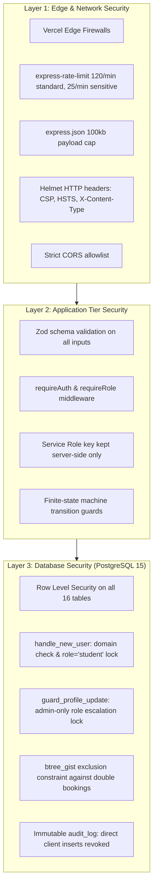

# 07 — Security Architecture & Threat Model

This document specifies the security controls, privilege boundary enforcements, worst-case threat models, and residual risks in **Amrita Yukti**.

---

## 1. Security Architecture & Defense in Depth

---

## 2. Threat Model: Worst Cases, Precaution & Residual Risk Matrix

| Threat / Worst-Case Scenario | What Happens | Precaution Implemented in Code | Residual Risk & Operational Mitigation |
| :--- | :--- | :--- | :--- |
| **1. Concurrency Race:** Two students book the exact same machine slot simultaneously. | Both submit `POST /api/bookings` at the exact same millisecond. | PostgreSQL `btree_gist` exclusion constraint triggers error `23P01`. First transaction commits (201); second receives `409 Conflict` with dynamically calculated alternatives. | Residual Risk: None at database level. Network delay might display slot as available in UI for a second prior to click. |
| **2. Inactive Project Pause:** Supabase free-tier project pauses after ~7 days of inactivity. | Database connections fail; queries return timeout errors. | Health check endpoint `/api/health` reports status `supabase_configured: false` and enables mock demo fallback. | Residual Risk: Real database unavailable until resumed via Supabase Web Dashboard. Pre-demo checklist mandates checking status 1 hour prior. |
| **3. Serverless Cold Start:** Initial request to Vercel takes 1–2 seconds. | Student experiences slight delay on initial page hit. | Pure Node.js ESM backend with zero heavy native binaries keeps bundle under 1MB; cold starts typically <800ms. | Residual Risk: Minor UI latency on first request. Pre-warming script (`GET /api/health`) runs before live demos. |
| **4. Serverless Rate Limiting Bypass:** Attacker spreads requests across instances. | In-memory `express-rate-limit` counts per serverless lambda rather than globally. | Rate limiters configured with `trust proxy: 1` per instance; sensitive routes capped aggressively at 25 req/min. | Residual Risk: Highly distributed botnet could bypass memory counters. Mitigation on roadmap: Shared Redis / Upstash rate limiting. |
| **5. Stolen or Expired JWT:** Malicious actor attempts replaying expired or forged tokens. | Token rejected by Supabase Auth cryptographic verification. | Supabase Auth issues short-lived JWTs (1 hour). Express `requireAuth` validates token with Supabase Auth API. | Residual Risk: Valid token stolen via XSS before expiry. Mitigated by Helmet CSP and avoiding token storage in plain HTML. |
| **6. Student Role Escalation:** Student attempts patching their profile to `admin`. | Student sends `PATCH /api/admin/users/:id/role` or updates Supabase directly. | Database trigger `guard_profile_update` raises SQL exception if `auth.uid()` changes `role` and is not admin. `requireRole('admin')` rejects API call with `403 Forbidden`. | Residual Risk: None. Enforced at both Express middleware and database trigger layers. |
| **7. Student Self-Approval:** Student tries approving their own machine booking. | Student sends `PATCH /api/bookings/:id { status: 'approved' }`. | Express route verifies `['faculty', 'lab_incharge', 'admin'].includes(req.role)` and explicitly blocks self-approval: `existing.user_id === req.user.id && req.role !== 'admin' -> 403`. Direct table writes are revoked in migration 004. | Residual Risk: None. |
| **8. Direct Client DB Manipulation:** Attacker invokes `supabase.from('facility_bookings').insert()` in browser console. | Client SDK attempts bypassing Express API. | Migration 004 dropped `facility_bookings_insert` and `facility_bookings_update` RLS policies for authenticated clients. Direct writes fail with `42501 (RLS violation)`. | Residual Risk: None. All writes must pass through Express API with service role. |
| **9. Malicious Upload / Zip Bomb:** Attacker uploads decompression bomb or executable. | Decompression could exhaust server memory. | Files are analyzed in browser memory; original files are not uncompressed on server. `inspectGerberZipBuffer` checks uncompressed ratios and caps at safe limits. | Residual Risk: Browser tab crash if student opens a 2GB zip locally. Server remains unaffected. |
| **10. Wrong File Extension / Type:** User selects "PCB Mill" but uploads `.stl` model. | Job queue would fail during lab manufacturing. | Pre-flight check inspects binary headers; displays UI mismatch warning banner before submission. | Residual Risk: None. |
| **11. Chatbot Abuse & Gemini Quota Drain:** Rapid spamming of `/api/chat`. | Attacker exhausts Google Gemini API rate limits. | Sensitive rate limiter (25 req/min); query length capped at 500 chars; 4s timeout; primary engine is deterministic rule-based, calling Gemini only as secondary fallback. | Residual Risk: Temporary Gemini 429 quota exhaustion. Chatbot continues operating cleanly on rule-based templates. |
| **12. Equipment Slot Hoarding:** Student books all slots across 5 days. | Legitimate innovators locked out of machines. | Hard cap of 5 active bookings (`pending`/`approved`) per student in `server/routes/bookings.js`; 8-hour maximum per booking; 30-day advance booking window cap. | Residual Risk: Student enlisting peers to book on their behalf. Handled by faculty manual review. |
| **13. Corrupt CSV Inventory Import:** User uploads malformed CSV with missing columns. | Database columns could be corrupted or populated with nulls. | Strict Zod schema validation (`importSchema`) requires `name` and `quantity >= 0`. Non-conforming rows reject with `400 Bad Request`. | Residual Risk: Typos in part numbers. Solved by in-charge re-uploading corrected CSV (last-write-wins). |
| **14. Duplicate Inventory Records:** Repeated imports create thousands of redundant rows. | Inventory table balloons; drawer counts display duplicates. | Migration 004 generates stable natural key `item_key = lower(trim(part_no || name))` and unique index `inventory_items_lab_key_uniq`, upserting cleanly. | Residual Risk: None. |
| **15. Clock / Timezone Drift:** Server in UTC, campus in IST. | Bookings scheduled for wrong hours or overnight. | Timezone module [`server/lib/time.js`](file:///d:/Project/Hackathon/server/lib/time.js) normalizes day boundaries to IST (`UTC+05:30`); scheduler enforces 08:30–17:30 IST window strictly. | Residual Risk: Client device having severely incorrect system clock. Server validates timestamps against server UTC time. |
| **16. Campus Wi-Fi Failure at Demo:** Internet drops during live faculty presentation. | Remote cloud calls fail. | `DEMO_OFFLINE=true` mock mode in Express allows offline UI navigation and fallback testing. | Residual Risk: Live database persistence disabled during offline mode. |
| **17. Accidental Secret Leak:** Developer commits `.env` file to public GitHub. | Supabase credentials exposed. | `.env` in `.gitignore`; `.env.example` contains placeholders only; service role key strictly separated from `VITE_` client variables. Rotation procedure documented below. | Residual Risk: Developer explicitly overriding gitignore. Prevented by git pre-commit scanning. |

---

## 3. Residual Risk Disclosures

To preserve absolute academic honesty:
1. **Header-Based Content Verification:**
   * `/api/jobs/verify-content` inspects a base64-encoded file header sent by the client (capped at 70 KB). While authenticated and size-capped, a sophisticated attacker could craft a valid 80-byte STL header followed by non-3D content.
   * *Mitigation on roadmap:* Full server-side streaming mesh analysis upon cloud storage integration.
2. **Client-Side File Storage:**
   * 3D models and Gerber archives are analyzed in the browser and not uploaded to Supabase Storage. Only file metadata, volume estimates, and estimated print duration are stored in PostgreSQL.

---

## 4. Emergency Secret Rotation Procedure

If `SUPABASE_SERVICE_ROLE_KEY` or `GEMINI_API_KEY` is accidentally leaked:
1. **Rotate Supabase API Keys:**
   * Navigate to: `Supabase Dashboard -> Project Settings -> API`.
   * Under **Project API keys**, click **Generate new key** for `service_role`.
   * Update the new key in Vercel: `Vercel Dashboard -> Settings -> Environment Variables`.
2. **Rotate Google Gemini API Key:**
   * Open `Google AI Studio -> API keys`.
   * Delete the compromised key and create a new key.
   * Update `GEMINI_API_KEY` in Vercel.
3. **Trigger Immediate Redeployment:**
   * In Vercel, navigate to **Deployments** $\rightarrow$ **Redeploy**.
