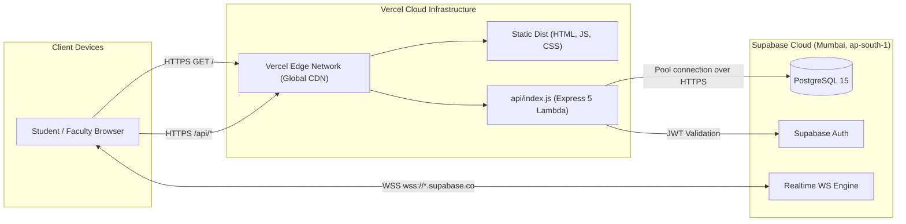

# 09 — Deployment & Hosting Architecture (Vercel & Supabase)

This document provides complete instructions for deploying **Amrita Yukti** to Vercel and managing cloud production environments.

---

## 1. Hosting Architecture: Hybrid Serverless



### How Serverless Routing Operates
* **Build Step:** Vercel runs `npm run build`, producing optimized client assets in `dist/`.
* **Rewrites ([`vercel.json`](file:///d:/Project/Hackathon/vercel.json)):**
  * `/api` and `/api/(.*)` route to `/api/index.js`.
  * All non-API paths route to `/index.html`, enabling client-side React SPA routing.
* **Entrypoint ([`api/index.js`](file:///d:/Project/Hackathon/api/index.js)):**
  ```javascript
  import app from '../server/server.js';
  export default app;
  ```
  Vercel automatically wraps the Express application instance in a Node.js serverless execution handler.

---

## 2. Step-by-Step Vercel Deployment

### Method A: GitHub Integration (Recommended)
1. **Push Code:** Ensure all commits are pushed to your GitHub repository:
   ```bash
   git push origin main
   ```
2. **Import Project into Vercel:**
   * Go to [vercel.com/new](https://vercel.com/new).
   * Select your repository `Genesis---Unscripted`.
3. **Configure Build Settings:**
   * **Framework Preset:** Vite
   * **Root Directory:** `./`
   * **Build Command:** `npm run build`
   * **Output Directory:** `dist`
4. **Configure Environment Variables:**
   Add each of the following in the Vercel dashboard:
   * `VITE_SUPABASE_URL` = `https://your-project.supabase.co`
   * `VITE_SUPABASE_ANON_KEY` = `your-anon-key`
   * `SUPABASE_URL` = `https://your-project.supabase.co`
   * `SUPABASE_SERVICE_ROLE_KEY` = `your-service-role-key`
   * `ALLOWED_ORIGINS` = `https://your-vercel-domain.vercel.app`
   * `GEMINI_API_KEY` = `your-gemini-key` (optional)
   * `GEMINI_MODEL` = `gemini-2.5-flash`
5. **Deploy:** Click **Deploy**. Vercel will build and assign a production URL (e.g., `https://amrita-yukti.vercel.app`).

### Method B: Vercel CLI (Optional)
If deploying via command line:
```bash
npx vercel login
npx vercel --prod
```

---

## 3. Production Environment Checklist & Redeployments

### Triggering Redeployments
* Any push to the `main` branch automatically triggers a production build on Vercel.
* For immediate manual redeployment without code changes:
  1. Open Vercel Dashboard $\rightarrow$ Click project $\rightarrow$ **Deployments**.
  2. Click the three dots `...` next to the latest deployment $\rightarrow$ **Redeploy**.

### Instant Rollbacks
If a problematic commit is deployed during a demo:
1. Go to **Deployments** tab in Vercel.
2. Locate the previous stable deployment.
3. Click `...` $\rightarrow$ **Promote to Production**. Rollback is effective within 2 seconds.

---

## 4. Free-Tier Limits & Keep-Alive Strategies

| Service | Free-Tier Constraint | Operational Impact | Mitigation & Keep-Alive Action |
| :--- | :--- | :--- | :--- |
| **Supabase Database** | Pauses after ~7 days of inactivity. | Database requests fail with connection timeouts. | **Pre-Demo Keep-Alive:** Open the Supabase Web Dashboard or run `curl https://your-project.supabase.co` 1–2 hours before the presentation to restore compute. |
| **Vercel Serverless Functions** | 10-second default execution timeout per request (Hobby tier). | Long-running tasks terminate early. | All Amrita Yukti API routes finish in <150ms; file processing is handled in the browser, well below limits. |
| **Vercel Serverless Cold Start** | Idle functions de-allocate memory after 15 mins. | First request after idle takes 800ms. | Send a pre-warm ping to `https://your-app.vercel.app/api/health` 5 minutes prior to presenting. |
| **Supabase Realtime Connections** | 200 concurrent client WebSocket connections. | Surplus connections fail. | Hook automatically cleans up connections on unmount via `supabase.removeChannel()` and falls back to polling if needed. |
