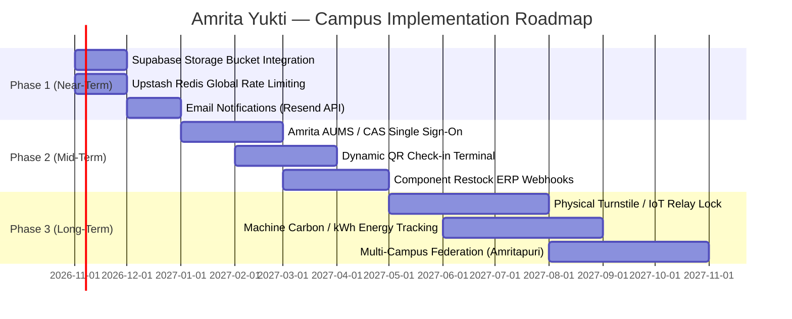

# 13 — Known Limitations & Strategic Roadmap

This document outlines the known architectural boundaries of the current implementation and sets out the phased engineering roadmap for campus deployment.

---

## 1. Honest Limitations of the Current Prototype

### 1. In-Browser File Analysis & Absence of Cloud File Bucket
* **Current Reality:** 3D model files (`.stl`) and Gerber PCB archives (`.zip`) are inspected entirely in client browser memory using signed tetrahedron geometry decomposition and magic-byte checks. The original binary CAD files are not uploaded to Supabase Storage or an AWS S3 bucket; only the calculated metadata (volume in $cm^3$, estimated duration, layer parameters) is stored in PostgreSQL.
* **Why this Decision was Made:** Slicing software on serverless backends imposes massive cold-start penalties and memory costs. In-browser inspection allows zero-cost instant pre-flight estimation.
* **Impact:** Lab in-charges can see file metrics, but currently receive physical USB drives or student email attachments for the original G-code.

### 2. Header-Based Content Verification
* **Current Reality:** The endpoint `/api/jobs/verify-content` inspects a base64-encoded file header (capped at 70 KB) sent by the client. While authenticated, size-capped, and checked against binary STL/Gerber signatures, a sophisticated attacker could craft a valid 80-byte header followed by non-3D payload data.
* **Impact:** Suitable for campus prototype; full streaming server-side verification is slated for production storage integration.

### 3. Serverless In-Memory Rate Limiting
* **Current Reality:** `express-rate-limit` maintains sliding-window request counts in the memory of each individual serverless instance.
* **Impact:** In a heavily distributed burst across multiple parallel serverless lambdas, an attacker could theoretically exceed the nominal 120 req/min threshold.

### 4. Supabase Free Tier Inactivity Sleep
* **Current Reality:** On the free tier, Supabase pauses database instances that receive no queries for approximately 7 consecutive days.
* **Impact:** Requires a wake-up ping or dashboard login before demonstrations.

### 5. Web Speech API Browser Dependency
* **Current Reality:** Hands-free voice recognition relies on browser-native `webkitSpeechRecognition`, which is fully supported on Google Chrome, Chromium, and Microsoft Edge, but has limited support on Firefox and Safari iOS.
* **Fallback:** Text input is universally available across all browsers and devices.

---

## 2. Strategic Engineering Roadmap

### Phase 1: Storage & Reliability Hardening (Months 1–2)
1. **Supabase Storage Integration:** Implement authenticated direct-to-storage uploads using presigned URLs with server-side SHA-256 hash validation.
2. **Distributed Global Rate Limiting:** Replace in-memory counters with `@upstash/ratelimit` backed by Redis edge KV.
3. **Automated Notification Service:** Send instant email / SMS notifications to students upon booking approval or cancellation.

### Phase 2: Campus ERP & Hardware Integration (Months 3–6)
1. **Institutional SSO:** Connect Supabase Auth to Amrita AUMS via SAML 2.0 / Microsoft Entra ID.
2. **Dynamic QR Check-In:** Generate time-expiring TOTP QR codes in the student portal, scanned by a tablet at the lab reception desk.
3. **Automated Purchase Orders:** Route approved purchase requests directly into department procurement SAP/ERP workflows.

### Phase 3: Hardware Interlocks & Multi-Campus Expansion (Months 6–12)
1. **IoT Power Relays:** Connect ESP32 microcontrollers to 3D printer power rails; power is only energized upon validated student check-in.
2. **Federated Multi-Campus Expansion:** Extend database schemas to support multiple Amrita campuses (Coimbatore, Amritapuri, Bengaluru, Kochi, Chennai).
